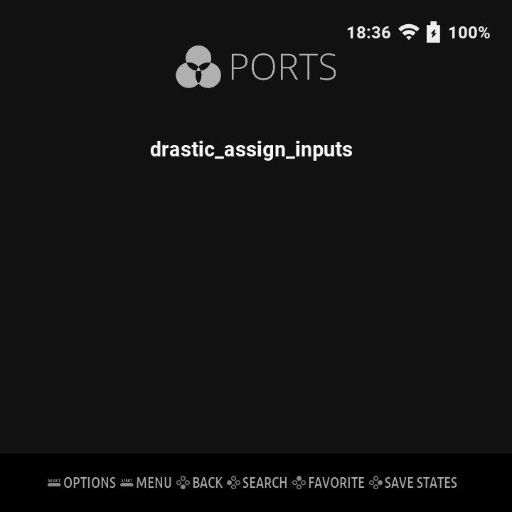
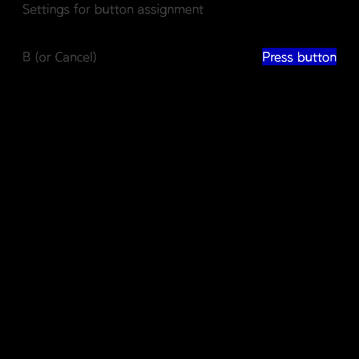

### advanced_drastic

This project was launched to overcome the limitations of screen output and input fixed as base with the drastic-steward 32-bit source developed for miyoomini by steward-fu.

### TOC
1. [history](#history)
2. [custom cheat](#custom-cheat)
3. [download location](#download-location)
4. [Installation Guide](#Installation-Guide)
4. [trouble shootings](#trouble-shootings)

### checksum
For normal operation, you must use the drastic file below. 
md5sum:59a7711eff41c640b8861b4d869c747d  drastic_v2520 
md5sum:a08e38854fe32d86b60167a1c43d9175  drastic_v2520 
md5sum:17550db727f3b59d36b57746ad1944be  drastic_v2522 

### Comapre between v2.5.0.4(32bit), v2.5.2.x(64bit)

functions|2.5.0.4|2.5.2.0|2.5.2.2
-----|-----|-----|----
rumble |X | O | O
touch input | X | O | O
audio output | ALSA | SDL2 | SDL2
audio input | ALSA | X| X
HW MIC | O | X | X
FAKE MIC | X | O | O
DQ IX graphical glitch| ? | has issue | no issue

### history

- The parts that differ from drastic-steward are as follows.

1. Hooked based on 64 bit drastic.
2. You can still use the drastic default input settings menu (keyboard/mouse/vibration support)
3. Configure the settings screen and layout screen based on the detected resolution.
4. You can configure a separate layout.json file to change the background image to define it.
5. Supports writing .sav files.

Other changings are as follows. 
[history](history.md)

### download location
The information below is old information. It will be updated further.

You can download the library from the following path. 
[libs](https://github.com/trngaje/advanced_drastic/tree/master/libs)  
Copy to `libadvdrastic.so` to `libs` folder  

Supports all devices with gpu.

The function for hooking drastic is defined on libadvdrastic.so.

- The devices that have been verified for operation are as follows. 

folder | platform | glibc version
-------| -------------| -----
knulli_muos_h700 | h700 devices(rg35xx-h/p/sp, rg34xx, rg40xx-h/v, rgcubexx, rg35xx for knull / muos) | 2.40
knulli_muos_a133p | a133 device(trimui smart pro / s, trimui brick for knulli ) with internal rumble | 2.40
tsp | a133 devices (trimui smart pro / s, trimui brick for crossmix os) with internal rumble | 2.33
rocknix | rk3566, rk3326, ogu devices (rg arc-s,rgb30,rgds .. for rocknix) | 2.40
dArkos | | 2.41
miyooflip | supports internal rumble | 2.36

Checked normal operation in various os. (knulli / muos / rocknix / crossmix or spruceos)

### Installation Guide

#### general script
common basic script to run drastic : launch.sh  
need to use LD_PRELOAD instead of libSDL2* to hook drastic functions
~~~
#!/bin/sh

mydir=`dirname "$0"`

export LD_LIBRARY_PATH=$mydir/libs:$LD_LIBRARY_PATH

cd $mydir

CURRENT_DIR=`pwd`

unset LD_PRELOAD
export LD_PRELOAD=$CURRENT_DIR/libs/libadvdrastic.so

./drastic "$1"
~~~

The installation guides for each OS are as follows.  
[The installation guides](install.md)

### Key settings

key | assign
---------------|--------
<kbd>l2</kbd> | toggle stylus / dpad
<kbd>r2</kbd>  | swap screen0/1
<kbd>menu</kbd> | call setting menu
<kbd>select</kbd> | hot key
<kbd>select</kbd> + <kbd>left</kbd>  | dec index of layout
<kbd>select</kbd> + <kbd>right</kbd>  | inc index of layout
<kbd>select</kbd> + <kbd>y</kbd>  | change themes
<kbd>select</kbd> + <kbd>b</kbd>  | toggle blur / pixel mode
<kbd>select</kbd> + <kbd>start</kbd> | exit
<kbd>select</kbd> + <kbd>l</kbd>  | quick load
<kbd>select</kbd> + <kbd>r</kbd>  | quick save

### Configure folders
~~~
├── libs (external)
├── config
│   └── drastic.cfg
├── devices
│   ├── rg28xx
│   │   ├── config
│   │   │   └── drastic.cfg
│   │   └── resources
│   │       └── settings.json
│   ├── rg35xx-sp
│   │   ├── config
│   │   │   └── drastic.cfg
│   │   └── resources
│   │       └── settings.json
│   ├── trimui-brick
│   │   └── config
│   │       └── drastic.cfg
│   └── trimui-smart-pro
│       └── config
│           └── drastic.cfg
├── drastic_v2522
├── drastic_v2520
├── launch.sh
├── microphone
│   └── microphone.wav
├── resources
│   ├── bg (external)
│   ├── font
│   ├── lang
│   ├── menu
│   ├── pen
│   └── settings.json
├── system
│   ├── drastic_bios_arm7.bin
│   └── drastic_bios_arm9.bin
└── usrcheat.dat
~~~

### fake microphone

`microphone.wav` : default wav (16bit mono) file for all roms  
`[name_of_rom].wav` : wav file for individual rom  

### stylus cursor

name| image
-----|-----
1_lt.png | 
2_lb.png | 
3_rt.png |  
4_lb.png |  
5_rb.png |  
6_cp.png |  
7_lb.png |  

### How to capture logs for debug in ssh
(The next version will create an advdrastic.log file.)

~~~
# tty
/dev/pts/0
~~~

edit launch.sh
~~~
drastic "$1" > /dev/pts/0 2>&1
~~~

### parameters1 : input assign
in order to input the buttons sequentially, write a script as below and execute the drastic.

drastic_assign_inputs.sh
~~~
#!/bin/bash
~/advanced_drastic/launch.sh --input-assign
~~~

*****

### executable format

By default, the original drastic supports the **.nds**, **.zip**, **.7z** ,**.rar** format.

### custom cheat

Cheats are specified in the cheat file with the following format:

[Cheat Name]+ 
For example, a file Mario_Kart.cht may have the following contents:

~~~
[Always Be Shyguy]+
923cdd40 0000000c
023cdd40 00000001
d2000000 00000000
94000130 fffb0000
023cdd40 0000000c
d2000000 00000000
~~~
The + after the cheat name is used to specify that the cheat is activated. If
the + is removed the cheat will be ignored.

### layout

The layout resources are managed in the following path. 
[https://github.com/trngaje/drastic_layout](https://github.com/trngaje/drastic_layout)

### external shader

You can use the shader files (.dfx/.dsd) used in Android drastic as they are.
[https://github.com/jdgleaver/drastic_ds_shaders](https://github.com/jdgleaver/drastic_ds_shaders)

### multi-language

resources/lang/*  
syntax  
[English Menu Name]=[Translated Menu Name] 
ex) korean_kr  
~~~
Load state=빠른 저장 불러오기
Save state=빠른 저장 하기
Options=옵션
Controls=입력 설정
Performances=성능
Screens configuration=화면 설정
NDS Firmware=NDS 펌웨어
Cheats=치트
Load new game=새로운 게임 불러오기
Restart game=게임 재 시작하기
Return to game=게임으로 돌아가기
Exit DraStic=끝내기
About=정보
~~~

### trouble shootings

1. NDS has screen0 and screen1. stylus pen is used in screen1. In some roms, there is a case where the cursor is displayed on screen0 rather than screen1, which is a drastic original problem. If I know the rom, I can temporarily modify it to be displayed on the other screen. Please report to me.  
known roms :  
"Minna de Asobou - Shanghai DS 2"  

[Support for devices or assistance in purchasing devices is always welcome.](https://ko-fi.com/trngaje)  

If you need any improvements, please feel free to communicate your opinion in the discord below  

